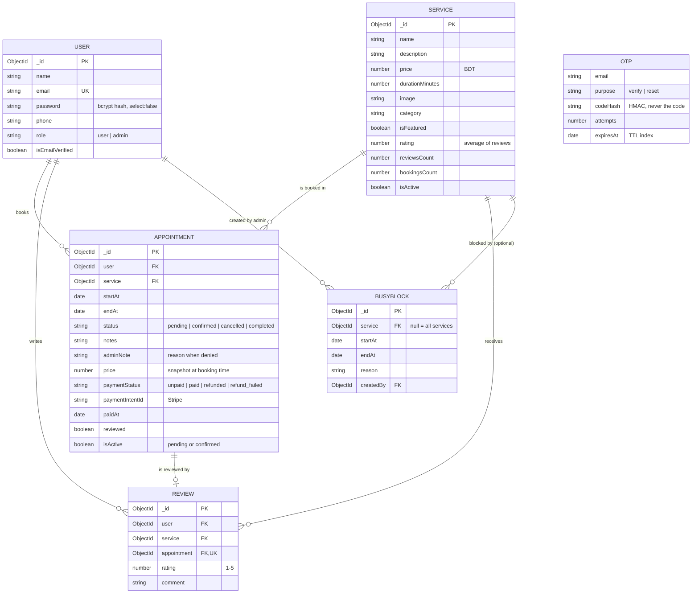

# Database design (MongoDB)

## ER diagram

## Relationships
- One **User** has many **Appointments**.
- One **Service** has many **Appointments**.
- An **Appointment** belongs to exactly one User and one Service. `price` is copied from the service so later price changes do not alter past bookings.

## Indexes
| Collection | Index | Purpose |
|------------|-------|---------|
| users | `email` unique | one account per email |
| services | `{category, price}`, `{isFeatured, bookingsCount}` | filtering and popular sorting |
| appointments | `{user, startAt}` | "My bookings" |
| appointments | `{service, startAt, endAt}` | overlap queries |
| appointments | `{service, startAt}` **unique, partial (`isActive: true`)** | blocks double booking under concurrency |

## Setup
1. Install MongoDB locally, or create a free MongoDB Atlas cluster.
2. Put the connection string in `.env` as `MONGO_URI`.
3. `npm run seed` creates the collections, indexes (via Mongoose), sample services and the demo/admin accounts.

## New in v2
- **Otp**: one live code per `(email, purpose)`. Stored as an HMAC hash, expires after 10 minutes (MongoDB TTL index), max 5 attempts, 60 s resend cooldown. Not related to other collections.
- **Review**: one per completed appointment (`appointment` is unique). Saving a review recalculates `Service.rating` and `Service.reviewsCount`.
- **BusyBlock**: admin-defined unavailable time. `service = null` blocks every service. Slots overlapping a block are returned with `available:false, reason:"busy"` and cannot be booked.
- **Appointment** gained payment fields (Stripe) and `adminNote`.
- Existing databases: run `npm run seed` once. It marks accounts created before v2 as verified so nobody is locked out.
